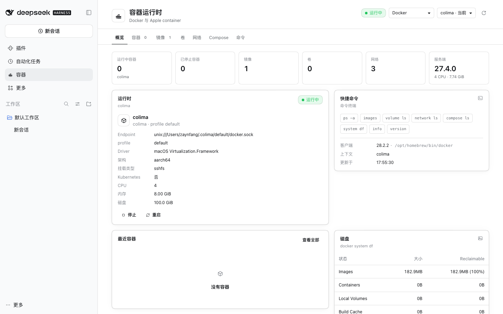

# DSH Container

English | [简体中文](README.zh-CN.md)



A DSH sidebar panel for managing containers on macOS: Docker (colima / Docker Desktop / OrbStack / remote contexts) and Apple `container`.

## Features

- Two providers, Docker and Apple container, with runtime status and context switching
- Containers, images, volumes, networks, Compose, and commands
- Start / stop / restart / delete containers; pull / inspect / delete images
- Logs, inspect, and live follow
- **Attach**: `docker attach` for Docker; `container exec` for Apple
- **Exec**: open a shell inside a container (`docker exec -it <id> /bin/sh`)
- Image architecture column (arm64/amd64)
- Read-only AI tools: `container_status`, `container_list`, `container_inspect`, `container_logs`
- AI diagnosis opens a separate session and leaves the current conversation untouched

## Requirements

- macOS
- DSH 0.2.x
- Docker CLI, or [Apple container](https://github.com/apple/container)
- Configure any network proxy for your own environment

## Install

GitHub: https://github.com/Zaynervewreck/dsh-plugin-container

```bash
dsh plugin --profile desktop add dsh-plugin-container
```

Restart DSH. The installer writes `dsh.profile.bundles` for you, so **you do not need to edit `cordis.patch.yml` by hand**.

Local development build:

```bash
node scripts/install-profile.mjs --home "$HOME/.dsh" --profile desktop
```

Do not enable source-path mode and npm-package mode at the same time.

## Usage

1. Open **Containers** in the left sidebar
2. Switch between Docker and Apple container at the top
3. Container row actions:
   - Start / stop / restart / delete
   - Logs / Follow / Inspect
   - Attach: take over the container's main process
   - Exec: open a new shell inside the container
   - Ask AI / Diagnose: starts a separate DSH session that calls the read-only container tools
4. The Images tab shows architecture and can start a container directly from an image

## Security

- All Docker/Apple commands run with the current user's permissions
- No shell string concatenation; commands are split into argv and spawned directly
- Dangerous actions such as delete, stop, and prune require confirmation
- AI tools are read-only; there are no start/stop/rm/prune tools
- Logs and inspect output are marked as untrusted data and are never executed as instructions

## Release

Releases are published by GitHub Actions. The npm token is stored in the repository secrets:

1. GitHub repository → Settings → Secrets and variables → Actions
2. Create `NPM_TOKEN` with an npm Granular Access Token (Bypass 2FA, Read and write)
3. Bump the version and tag:

```bash
npm version patch
git push --follow-tags
```

The `Release` workflow checks that the tag matches the `package.json` version, then runs:

```bash
npm publish --access public --provenance
```

## Development

```bash
npm install
npm run build     # src/client -> lib/client.js
npm test          # 46 tests
npm pack          # pre-release check
```

> `@deepseek-ai/dsh-tools` is provided by the host app. **Do not** add it to `dependencies` or `peerDependencies`. Otherwise installing the plugin puts an older copy in the profile's `node_modules`, which shadows the host's own version, leaves the `tools` service missing, and DSH fails to start. Keep it in `devDependencies` only.

Layout:

```text
index.js                 Host entry
cordis.patch.yml         Bundle install patch
src/host/service.js      Provider routing + Docker
src/host/apple.js        Apple container
src/host/attach.js       Attach/Exec PTY
src/host/tools.js        Read-only agent tools
src/client/              Pages, tabs, i18n, styles
```
