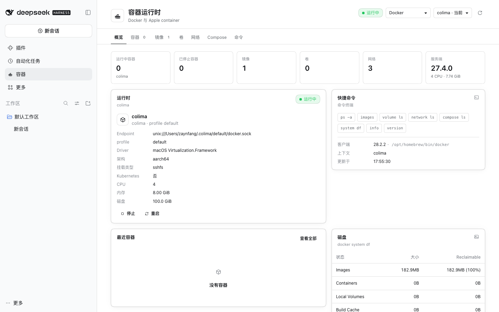

# DSH 容器

[English](README.md) | 简体中文



DSH 左栏容器面板：管理 macOS 上的 Docker（colima / Docker Desktop / OrbStack / remote context）和 Apple `container`。

## 功能

- Docker / Apple container 双 provider，运行时状态、上下文切换
- 容器、镜像、卷、网络、Compose、命令
- 容器启动/停止/重启/删除，镜像 pull/inspect/delete
- 查看日志、inspect、实时 follow
- **Attach**：Docker `docker attach`；Apple `container exec`
- **Exec**：进入容器内部 shell（`docker exec -it <id> /bin/sh`）
- 镜像架构列（arm64/amd64）
- 只读 AI 工具：`container_status`、`container_list`、`container_inspect`、`container_logs`
- AI 诊断会新建独立会话，不污染当前对话

## 要求

- macOS
- DSH 0.2.x
- Docker CLI；或安装 [Apple container](https://github.com/apple/container)
- 网络代理按本机环境配置

## 安装

GitHub: https://github.com/Zaynervewreck/dsh-plugin-container

```bash
dsh plugin --profile desktop add dsh-plugin-container
```

重启 DSH。安装器会自动写入 `dsh.profile.bundles`，**不需要手改 `cordis.patch.yml`**。

本地开发版：

```bash
node scripts/install-profile.mjs --home "$HOME/.dsh" --profile desktop
```

源码路径模式与 npm 包模式不要同时启用。

## 使用

1. 左栏打开 **容器**
2. 顶部切换 Docker / Apple container
3. 容器行操作：
   - 启动 / 停止 / 重启 / 删除
   - 日志 / Follow / Inspect
   - Attach：接管容器主进程
   - Exec：在容器内开一个新 shell
   - 问 AI / 诊断：新建独立 DSH 会话，调用只读容器工具
4. 镜像 tab 可查看架构，或直接用镜像启动容器

## 安全

- 所有 Docker/Apple 命令以当前用户权限执行
- 无 shell 拼接；命令拆成 argv 直接 spawn
- 删除、stop、prune 等危险操作需要确认
- AI 工具只读，不提供 start/stop/rm/prune tool
- 日志和 inspect 被标记为不可信数据，不能作为指令执行

## 发布

发布由 GitHub Actions 完成，npm token 放在仓库 Secrets：

1. GitHub 仓库 → Settings → Secrets and variables → Actions
2. 新建 `NPM_TOKEN`，值为 npm Granular Access Token（需要 Bypass 2FA、Read and write）
3. 更新版本并打 tag：

```bash
npm version patch
git push --follow-tags
```

`Release` workflow 会校验 tag 与 `package.json` 版本一致，然后执行：

```bash
npm publish --access public --provenance
```

## 开发

```bash
npm install
npm run build     # src/client -> lib/client.js
npm test          # 46 tests
npm pack          # 发布前检查
```

> `@deepseek-ai/dsh-tools` 由宿主应用提供，**不要**加进 `dependencies` / `peerDependencies`。否则安装插件时会在 profile 的 `node_modules` 里装一份旧版，盖住宿主自带的版本，导致 `tools` 服务缺失、DSH 启动失败。它只放在 `devDependencies`。

主要结构：

```text
index.js                 Host 入口
cordis.patch.yml         bundle 安装 patch
src/host/service.js      provider 路由 + Docker
src/host/apple.js        Apple container
src/host/attach.js       Attach/Exec PTY
src/host/tools.js        只读 Agent Tools
src/client/              页面、tabs、i18n、styles
```
